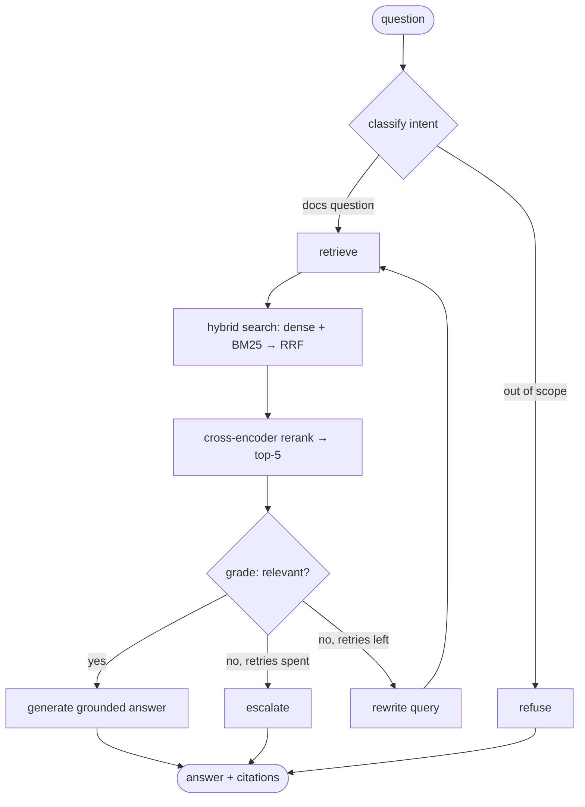

# DocStage

**An agentic RAG assistant over the FastAPI documentation — it grades its own retrieval, rewrites its own queries, and refuses questions it shouldn't answer.**

[](https://www.python.org/downloads/)
[](https://github.com/langchain-ai/langgraph)
[](LICENSE)

Ask a question in plain English. DocStage retrieves the real passages from the
FastAPI docs, checks whether they actually answer the question, searches again
with better terminology if they don't, and only then writes a grounded answer
**with citations**. If the docs can't answer it, it says so instead of guessing.

```bash
$ python ask_agent.py "How do I make an endpoint only logged-in users can access?"
-> classify
   intent: docs_question
-> retrieve
-> grade
   relevant: True
-> generate

Use a dependency that validates the token and raises 401 when it fails...

Sources:
  - security-first-steps.md
  - get-current-user.md
```

Every stage in that pipeline was added to move a specific number on a
29-question evaluation set — not because it sounded impressive. The
[measured results](#measured-results) are below, and the
[evaluation harness](evaluate.py) that produced them is in the repo.

---

## Why this exists

A plain vector-search RAG pipeline fails in ways that are invisible until you
measure them. On this corpus the beta baseline retrieved the right document
into the top 5 **86%** of the time, but ranked it *first* only **41%** of the
time — and it missed four questions outright, including "how do I accept a JSON
payload?", where the embedding model never surfaced the right doc because the
question and the docs share almost no vocabulary.

DocStage is the record of fixing that, one measured step at a time: hybrid
retrieval and cross-encoder reranking took hit@1 from **41% → 76%** and MRR
from **0.612 → 0.819**, and a LangGraph agent layer added the ability to
notice bad retrieval and try again instead of answering anyway.

## Architecture



Two phases, as in any RAG system — but the query phase is a state machine, not
a straight line:

**Indexing** (once) — load 155 markdown files → split into ~1,960 chunks
(1000 chars, 150 overlap) → embed locally → persist to Chroma.

**Query** (per question) — the graph above. The loop is what makes it agentic:
bad retrieval doesn't produce a bad answer, it produces *another attempt*.

### The retrieval stack

| Stage | What it does | Why it's there |
|-------|--------------|----------------|
| **Dense search** | Embedding similarity over Chroma | Catches meaning matches when wording differs |
| **BM25 keyword search** | Lexical scoring over the same chunks | Catches exact terms — function names, error codes — that embeddings blur |
| **RRF fusion** | `score = Σ 1/(60 + rank)` across both lists | A doc ranked well by *either* search rises; no score normalization needed |
| **Cross-encoder rerank** | Re-scores question+chunk pairs jointly over a 20-candidate pool | Fixes *ordering*, which is what hit@1 and MRR actually measure |

### The agent layer

| Node | Role |
|------|------|
| **classify** | Routes out-of-scope questions to a refusal before spending retrieval or generation on them |
| **grade** | Structured-output check: do these chunks actually answer the question? |
| **rewrite** | Reformulates the query in the docs' own terminology, then searches again |
| **escalate** | After `MAX_REWRITES` failed attempts, admits defeat and says what it tried |

## Measured results

All numbers from `evaluate.py` on a hand-labelled 29-question set
([`questions.json`](questions.json)), post-warmup, embeddings
`all-MiniLM-L6-v2`, reranker `ms-marco-MiniLM-L6-v2`, LLM `openai/gpt-oss-120b`
via Groq.

**Headline: hit@1 went 41% → 55% → 76% across the three retrieval stages, and
MRR went 0.612 → 0.819.** Full ablation, `k=5`:

| Setup | hit@5 | hit@1 | MRR | hit@20 (pool) |
|-------|------:|------:|----:|--------------:|
| Dense only *(beta baseline)* | 86% | 41% | 0.612 | — |
| BM25 only, default tokenizer | 55% | 28% | 0.379 | — |
| BM25 only, clean tokenizer | 79% | 55% | 0.636 | — |
| Hybrid, default tokenizer | 90% | 52% | 0.664 | — |
| Hybrid, clean tokenizer | 86% | 55% | 0.670 | 97% |
| Dense + reranker | 93% | 69% | 0.787 | 100% |
| **Hybrid + reranker** *(current)* | **93%** | **76%** | **0.819** | 97% |

> [!NOTE]
> `hit@5` asks whether the right doc was retrieved *at all*; `hit@1` and `MRR`
> ask whether it was ranked **first**. Separating them is the point — hybrid
> search moves recall, reranking moves ordering. Reranking is what actually
> earned its place here: +7pts hit@5 but +21pts hit@1.

**What the ablation shows:**

- **The BM25 tokenizer matters more than adding BM25 at all.** Stripping
  stopwords took BM25-only from 55% → 79% hit@5 and nearly doubled its MRR.
  With the default whitespace tokenizer, keyword search was actively worse
  than dense alone.
- **Hybrid's gain is in ordering, not recall.** Hybrid-clean matches dense on
  hit@5 (86%) but lifts hit@1 from 41% → 55%. Fusion surfaces the right doc
  *higher*, which is what MRR captures and raw hit-rate hides.
- **The pool ceiling explains the remaining gap.** `hit@20 (pool)` is 97% for
  hybrid — the correct doc is almost always among the candidates, so the
  residual error is a *ranking* problem, not a retrieval one. Interestingly
  dense-only reaches 100% pool coverage, meaning hybrid's RRF occasionally
  pushes one correct doc out of the top 20. That's the next thing to chase.

Reproduce any row:

```bash
RETRIEVAL_MODE=dense  RERANK=0 python evaluate.py   # dense baseline
RETRIEVAL_MODE=bm25   RERANK=0 python evaluate.py   # BM25 only
RETRIEVAL_MODE=hybrid RERANK=0 python evaluate.py   # + hybrid fusion
RETRIEVAL_MODE=hybrid RERANK=1 python evaluate.py   # + reranking (current)
```

Add `BM25_CLEAN_TOKENS=0` to any BM25 or hybrid row to reproduce the
default-tokenizer variants.

### Latency, groundedness, and what isn't measured yet

Being explicit about the gaps, because a metric table without them is marketing:

| Measurement | Result | Status |
|-------------|--------|--------|
| Retrieval p50, hybrid alone | ~50–180 ms | Varies between runs |
| Retrieval p50, with reranker | 3–6 s (CPU) | ⚠️ Not profiled — see [Limitations](#limitations) |
| Groundedness (LLM judge, 1–5) | avg 4.5, 5/6 scored ≥4 | Only 6 questions, on the older dense pipeline |
| Agent routing accuracy | 8/8 correct by hand | Not yet automated |

The reranker's 3–6s CPU cost is the single biggest open issue: it buys +21pts
hit@1 for a ~30× latency increase. Batching, ONNX export, or a smaller
cross-encoder are the obvious levers, none tried yet.

Groundedness and agent routing both need the same treatment the retrieval
metrics already got — a full run over all 29 questions on the *current*
pipeline, with routing accuracy, rescue rate (how often a rewrite turns a MISS
into a hit) and escalation rate recorded.

> [!NOTE]
> **Label correction pending.** The retrieval runs above used the original
> label for the "accept a JSON payload" question. That label was later found to
> be wrong — `index.md` does answer it — so the corrected numbers would likely
> be one question higher across the board. The table reports what was actually
> measured, not the adjusted figure.

### Known failure modes

The four questions the beta baseline missed, kept as regression tests:

- **"path param greater than zero"** → returned query-params instead of
  path-params-numeric-validations (path-vs-query confusion)
- **"apply a dependency to every route"** → returned bigger-applications
  instead of global-dependencies (adjacent-vs-about)
- **"read a custom header"** → returned response-headers instead of
  header-params (request-vs-response confusion)
- **"accept a JSON payload"** → `body.md` absent entirely (vocabulary gap).
  *Re-examining this one showed the eval label itself was wrong — `index.md`
  also answers the question. A retrieval "miss" that turns out to be a
  mislabelled ground truth is its own lesson about trusting your eval set.*

## Quickstart

**Prerequisites:** Python 3.11+, and a [Groq API key](https://console.groq.com/keys)
(free tier is enough). Embeddings and reranking run locally — no key needed for those.

```bash
# 1. Clone and install
git clone https://github.com/Ahmad-Zia10/DocStage.git
cd DocStage
python -m venv .venv && source .venv/bin/activate   # Windows: .venv\Scripts\activate
pip install -r requirements.txt

# 2. Add your key
cp .env.example .env        # then paste your GROQ_API_KEY into .env

# 3. Fetch the corpus (the FastAPI docs we answer from)
git clone --depth 1 https://github.com/fastapi/fastapi.git ../fastapi

# 4. Build the index (once, ~1 min — downloads the embedding model)
python ingest.py
```

## Usage

```bash
# Ask the full agent (classify → retrieve → grade → rewrite/generate)
python ask_agent.py "How do I handle file uploads?"

# Ask the straight-line chain (no grading, no retries — the beta pipeline)
python ask.py "How do I handle file uploads?"
python ask.py                      # interactive mode

# Measure it
python evaluate.py                 # retrieval metrics + latency (free, no LLM)
python evaluate.py --answers       # also print generated answers
python evaluate.py --judge         # also LLM-judged groundedness (1-5, uses API)
```

`ask_agent.py` streams each node as it fires, so you can watch the graph make
decisions — which intent it assigned, whether the grader passed the chunks, and
what it rewrote the query to when it didn't.

## Repository layout

| Path | Role |
|------|------|
| [`config.py`](config.py) | Every knob: paths, chunk size, `TOP_K`, retrieval mode, rerank toggle, model choices |
| [`ingest.py`](ingest.py) | Indexing phase — load → chunk → embed → persist to Chroma |
| [`rag.py`](rag.py) | Retrieval stack (dense, BM25, RRF, rerank) + grounded generation |
| [`agent/state.py`](agent/state.py) | The `AgentState` TypedDict passed between nodes |
| [`agent/nodes.py`](agent/nodes.py) | Node functions: classify, grade, rewrite, generate, escalate |
| [`agent/graph.py`](agent/graph.py) | Wires nodes into the LangGraph state machine |
| [`ask_agent.py`](ask_agent.py) | CLI for the agent, with per-node step streaming |
| [`ask.py`](ask.py) | CLI for the straight-line chain |
| [`evaluate.py`](evaluate.py) | Eval harness: hit@k, hit@1, MRR, pool ceiling, latency, LLM judge |
| [`questions.json`](questions.json) | 29 hand-labelled eval questions with accepted source docs |
| [`ROADMAP.md`](ROADMAP.md) | Build plan — each stage names the metric it must move |

## Design decisions

**Hand-written RRF instead of LangChain's `EnsembleRetriever`.** The library
version returns the union of both halves — up to `2 × k` documents — which
silently inflates any `hit@k` comparison against a `k`-document baseline. Thirty
lines of explicit fusion made the cut-to-`TOP_K` visible and added a
`RETRIEVAL_MODE` switch, so dense, BM25 and hybrid are measurable against each
other on identical `k`.

**Custom BM25 tokenizer.** LangChain's default splits on whitespace, so
stopwords like "how", "do", "I" carry lexical weight and drag in noise — "json"
matched release notes before the body docs. Stripping them is a one-function
change ([`rag.py`](rag.py)) behind the `BM25_CLEAN_TOKENS` flag, which is how
the effect got measured rather than assumed: **BM25-only went from 55% → 79%
hit@5 and 0.379 → 0.636 MRR.** Without that fix, adding keyword search would
have *hurt* the pipeline.

**Structured output for grading and classification.** Both nodes use Pydantic
schemas with `Literal` fields rather than parsing free text for "yes"/"no". A
grader that occasionally replies "Yes, because..." breaks string matching, and
that failure is silent.

**Local embeddings and reranking.** Runs free and offline; the only API cost is
generation. `EMBEDDING_PROVIDER` swaps in Voyage or OpenAI when quality matters
more than cost.

**Cross-encoder over a 20-candidate pool.** Rerankers are accurate but
quadratic in cost, so they can't run over the whole corpus. Fusing first and
reranking a shortlist gets most of the ordering benefit for a bounded number of
model calls.

## Roadmap

Each stage must beat the previous stage's number before the next one starts —
see [ROADMAP.md](ROADMAP.md) for the full plan and "done when" gates.

**Phase 1 — Beta** ✅
- [x] Ingestion: load → chunk → embed → store (Chroma)
- [x] Query: retrieve → grounded, cited generation
- [x] Eval harness: hit@k, hit@1, MRR, latency, LLM-judged groundedness

**Phase 2 — Alpha**
- [x] **2.1 Hybrid search** — BM25 + dense, fused with RRF
- [x] **2.2 Reranking** — cross-encoder over the fused candidate pool
- [ ] **2.3 Knowledge graph (GraphRAG)** — 🚧 *in progress* — entity/relationship
      index for multi-hop "what depends on what" questions that flat retrieval misses
- [x] **2.4 LangGraph agent** — intent routing, relevance grading, query
      rewriting, escalation
- [ ] **2.5 MCP tools** — let the agent act (e.g. open a GitHub issue), not just answer

**Phase 3 — Production**
- [ ] Guardrails: PII handling, prompt-injection defense, out-of-scope refusal
- [ ] Human-in-the-loop handoff for low-confidence answers
- [ ] Feedback loop: thumbs-down → new eval cases
- [ ] Caching + cost/latency controls
- [ ] Deploy: containerize, CI, one cloud target

## Limitations

- **The reranker costs 3–6s per query on CPU.** It buys the biggest accuracy
  jump in the pipeline (+21pts hit@1) at roughly 30× the latency of fusion
  alone. Unprofiled and unoptimized — batching, ONNX export or a smaller
  cross-encoder are untried. Set `RERANK=0` to trade the accuracy back for speed.
- **BM25 rebuilds in memory at startup.** The keyword index isn't persisted, so
  every process re-chunks all 155 docs (a few seconds). This also makes
  `DOCS_DIR` a *query-time* dependency, not just an indexing one.
- **Groundedness and agent routing are under-measured.** Groundedness has only
  been judged on 6 questions, on an older pipeline; routing has only been
  checked by hand on ~8. Both need a full 29-question run before any claim
  rests on them.
- **The grader shares the generator's model.** A model that misjudges relevance
  may also misjudge its own grounding, so the two checks aren't independent.
- **29 eval questions is small.** Enough to catch regressions and rank
  approaches, not enough for tight confidence intervals — a 1-question change
  moves any rate by ~3.4pts.
- **Single corpus, single language.** English FastAPI docs only; no
  multi-tenancy or per-user isolation.

## License

MIT — see [LICENSE](LICENSE).
